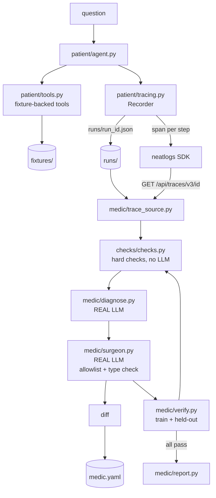

# Medic — the self-healing agent

**Agents don't crash — they quietly go wrong.** Medic reads a failing agent's
[neatlogs](https://neatlogs.com) trace, finds the broken step, patches **one
file** (`medic.yaml`), re-runs the agent, and proves the fix with hard
deterministic checks — including on held-out tasks it never saw.

Built for [neatHack 2026](https://docs.neatlogs.com) · hackathon by **cipoklean**

---

## The two-minute demo

> Full shot list, including what to say if a provider fails on camera:
> [`docs/demo_script.md`](docs/demo_script.md).

```bash
cd medic
cp .env.example .env        # add NEATLOGS_API_KEY + an LLM key
set -a && . ./.env && set +a # so .env wins over any stale LLM_* in your shell
uv venv --python 3.13 .venv && uv pip install --python .venv/bin/python -r requirements.txt

.venv/bin/python cli.py doctor
.venv/bin/python cli.py run  --bug loop --llm real    # the failing run, with its cost
.venv/bin/python cli.py heal --bug loop --llm real    # diagnose → diff → verify → HEALED
```

You will see: a red failing run with its measured cost → a diagnosis naming the
broken span → a coloured diff against `medic.yaml` → a green re-run → a
held-out results table → **HEALED**, with before/after numbers.

No Streamlit, no web server, and the agent's tools never touch the network.

> **The scripted path is not a substitute for the heal.**
> `--llm scripted` works for `run`, `report` and `reset`, but **not** for `heal`.
> Medic's diagnose and surgeon steps always use the real LLM — a scripted model
> diagnosing a scripted patient would be grading its own homework. With no key
> configured, `heal` fails loudly and says which variables are missing.

---

## What it does

A small research agent (`patient/`) answers questions with three fixture-backed
tools. It breaks in four documented ways, and Medic repairs it.

```
failing trace ──► diagnose ──► surgeon ──► patch medic.yaml ──► verify
   (neatlogs)      real LLM      real LLM      ONE file          train + held-out
                                          (never Python)      hard, no LLM
```

### The rule that matters

**Medic edits exactly one file: `medic.yaml`.** Never Python. Allowed fields:

| Field | Typical fix |
|---|---|
| `system_prompt` | restore a stop rule, require fetched evidence |
| `tools.<name>.description` | state the argument format with an example |
| `max_steps` | cap runaway loops |
| `retry_on_parse_error` | let the agent recover from a malformed payload |

The allowlist and type checks are enforced **in code**, not in the prompt — a
model asking to patch a Python file, or to set `max_steps: "eight"`, is refused
before it can write anything.

### "Green" means hard checks pass

No LLM is ever asked whether the agent did well. The checks are:

| Bug | Hard check |
|---|---|
| 1 · wrong args | every tool call validates against its JSON schema **and** the answer equals the known value |
| 2 · malformed JSON | no unhandled parse error escapes **and** the answer is still correct |
| 3 · infinite loop | finishes within N steps **with** a final answer |
| 4 · hallucinated citations | every cited URL appeared in a `fetch_page` result **from that run** |

A heal counts only when the train task **and every held-out task** pass.
Stopping on the train task alone is how a self-healing tool learns to overfit.

---

## Measured results

Every number below was produced by a real run and read back from that run's own
recorder. None is estimated.

### The live heal — bug 2 (`parse_error`), Bedrock nova-micro + Sonnet

Patient: `litellm:nova-micro` (Amazon Nova on Bedrock).
Medic: `litellm:claude-sonnet-4.6` (Anthropic on Bedrock).

| | steps | tokens | result |
|---|---|---|---|
| before (buggy preset) | 2 | 2,020 | **FAIL** — `JSONDecodeError: Illegal trailing comma` |
| after — train `parse-error-solar` | 3 | 4,721 | PASS |
| after — held-out `parse-error-gadgets` | 1 | 1,950 | PASS |
| after — held-out `parse-error-widgets` | 1 | 1,910 | PASS |
| clean-config control | 3 | 4,707 | PASS |

Reproduced **3/3** on the train task, with `parse_err_seen=True` in every run and
the failing span on `fetch_page` in the trace.

Medic diagnosed it **from the trace, with no hint**: `failing_span_id` named,
`failure_type: parse_error`, **confidence 0.95**, and the evidence quoted
verbatim — *"ERROR JSONDecodeError: Illegal trailing comma before end of object:
line 1 column 279 (char 278)"*. The patch was **one field, one boolean**:

```diff
-retry_on_parse_error: false
+retry_on_parse_error: true
```

Both held-out tasks passed. Full record:
[`evidence/real_heal_loop_parse_error.json`](evidence/real_heal_loop_parse_error.json).

**Cost per heal, measured:**

| | tokens | cost |
|---|---|---|
| Medic on Sonnet | 1,392 in + 204 out | **$0.007960** |
| Patient on nova-micro | 15,342 | **$0.001181** |
| **Total** | **16,938** | **$0.009141** |

The patient costs 13% of the heal; the medic's reasoning is the rest. Running the
medic on `claude-haiku` instead drops its share to **$0.002653** — a 3× saving
for a weaker diagnosis.

### Recorded, not live — bug 3 (`loop`), Groq gpt-oss-20b, Oct 10

`openai/gpt-oss-20b` (Groq), temperature 0, fixtures only:

| | steps | tokens | result |
|---|---|---|---|
| before (buggy preset) | 10 | 15,478 | **FAIL** — over the limit of 8 |
| after — train `loop-widgets` | 6 | 7,587 | PASS |
| after — held-out `loop-solar` | 5 | 4,872 | PASS |
| after — held-out `loop-gadgets` | 3 | 2,823 | PASS |

Diagnosed at **confidence 0.92** and patched with an explicit stop rule.
Record:
[`evidence/real_heal_loop.json`](evidence/real_heal_loop.json).

**Labelled "Groq, Oct 10".** Groq left the provider chain because its free tier
is 200,000 tokens/day and one take costs ~36–46k — four takes, no room to
rehearse. The evidence is kept so the run stays reproducible.

### The clean gate — 39/39

`medic.yaml` unmodified, `nova-micro`, **all 13 tasks × 3 runs = 39 passes, 0
misses**:
[`evidence/gate_nova_micro_clean.json`](evidence/gate_nova_micro_clean.json).

This is the footing every claim above stands on. It failed 4/13 the first time,
and **three of those four failures were the harness, not the model** — a wrong
expectation, a fixture the search could not reach, and a citation format the
config never specified. None would have surfaced without running a real model
against the clean baseline.

### Disclosure: `loop_strong` is a strengthened preset

The `laguna-s-2.1` run uses `bugs/presets/loop_strong.yaml`, **deliberately
strengthened** so a well-behaved model misbehaves (2/2, 40 steps). The original
`loop.yaml` does not reproduce on that model. Both presets are in the repo so
the difference is inspectable, and any number from `loop_strong` is labelled as
a strengthened preset rather than a discovered failure.

### The same buggy prompt breaks one model and not three others

A 10-second beat in the demo:

| Route | clean | same buggy prompt |
|---|---|---|
| `groq/gpt-oss-20b` — direct, Oct 10 | PASS 4 steps | **FAIL 12 steps** |
| `gpt-oss-20b` — OpenRouter pinned to Groq | PASS 4 | PASS 7 steps |
| `nara/laguna-s-2.1` | PASS 3–5 | PASS 4 steps |
| `nara/nemotron-3-ultra-free` | PASS 3 | PASS 4 steps |
| `nara/agnes-2.5-flash` | PASS 4 | PASS 5 steps |
| `nara/laguna-s-2.1` — **strengthened preset** | PASS 4–5 | **FAIL 40 steps** |

Full data:
[`evidence/loop_capability_matrix.json`](evidence/loop_capability_matrix.json).

## Honest limits

**Which bugs reproduce on which model — measured, not assumed:**

| Bug | `groq/gpt-oss-20b` | `nova-micro` (Bedrock) | `nova-lite` | `laguna-s-2.1` |
|---|---|---|---|---|
| `loop` | **FAIL 12 steps** | PASS | PASS | PASS (needs `loop_strong`) |
| `wrong_args` | FAIL | **PASS 3/3** | PASS | PASS |
| `parse_error` | — | **FAIL 3/3, train** | PASS | — |
| `hallucinated_citation` | — | PASS | PASS | PASS |

* **`parse_error` is the live heal.** It reproduces 3/3 on `nova-micro` and Medic
  heals it in one attempt. It is the strongest case because it is a **config
  defect, not a tuned prompt**: `retry_on_parse_error: false` plus a tool that
  returns malformed JSON. Teams ship exactly that, and the fix is one boolean.
* **`wrong_args` does NOT reproduce on Nova, and the reason is structural.** The
  preset only weakens the tool *description*; the JSON schema still declares
  `expression` as required, and nova-micro reads the schema and complies. The
  bug needs a model that leans on the description more than the schema.
* **`loop` was healed on `groq/gpt-oss-20b` — recorded evidence, Oct 10.** Groq
  left the provider chain: its free tier is 200,000 tokens/day and one take
  costs ~36–46k, which is four takes with no room to rehearse. The evidence is
  kept and labelled by date; it is not a live take.
* **`loop_strong` is a DELIBERATELY STRENGTHENED preset** so `laguna-s-2.1`
  reproduces (2/2, 40 steps). The original `loop.yaml` does not reproduce on
  that model. Any number from `loop_strong` is labelled as a strengthened
  preset, not a discovered failure.
* **The same weights routed to the same upstream behave differently.**
  `gpt-oss-20b` via Groq direct: 12 steps, FAIL. The identical model via
  OpenRouter with routing pinned to Groq (`allow_fallbacks=false`, verified
  `served provider: Groq`): 7 steps, PASS. **The route is part of the system
  under test.**
* **A real model at temperature 0 is NOT bit-identical across runs.** Two runs of
  the identical clean config on `laguna-s-2.1` took 3 and 4 steps. Every
  real-model figure here is an observation from a small number of runs. **The
  scripted agent is deterministic**, which is why it backs the tests.
* **Two task expectations were arithmetically wrong and a green suite hid both.**
  `parse-error-gadgets` expected `$10.00` for `169.98 − 79.99`; the answer is
  `$89.99`, and the scripted LLM returned `169.98-(79.99*2)` to match it. Both
  halves of the test agreed with each other and were both wrong. Every
  `expected_answer` is now re-derived from its fixture by
  `tests/test_expectations.py`, which caught a second error on its first run.
* **The search snippets used to leak the answers**, which made `fetch_page`
  optional and meant a bug living inside `fetch_page` could never fire. That is
  why `parse_error` first showed 0/9 with `parse_err_seen=False`. Snippets now
  carry no answer figures, and a test enforces it.
* * **Cost figures use the rate table in `patient/tracing.py`**, not a provider
  invoice.
* The offline suites prove the *machinery* — patch allowlist, verification,
  trace fallback. `tests/test_heal_machinery.py` calls
  `surgeon.deterministic_patch()` directly and **never calls an LLM**; a guard
  test fails if that ever changes.

---

## Which runs are scripted, and which are real

Stated plainly because the distinction changes what each result proves.

| | **scripted** (`--llm scripted`, the default) | **real** (`--llm real`) |
|---|---|---|
| Model | `patient/scripted.py`, deterministic, offline | any OpenAI-compatible endpoint |
| Network | none | LLM provider + neatlogs |
| Reproducible | **yes**, byte-for-byte | no |
| Proves | the harness and the checks are sound | a real model genuinely goes wrong, and can be healed |
| Used for | tests, CI, the **backup demo** | the live demo and the evidence above |

The scripted agent is **not** a canned-answer mock: it reads `medic.yaml` and
obeys it, so a vague tool description really does produce prose arguments and a
missing stop rule really does produce a loop. That is what makes the offline
demo honest.

Medic's own `diagnose` and `surgeon` steps **always use the real LLM** — a
scripted model diagnosing a scripted patient would be grading its own homework.
If no key is configured they fail loudly rather than silently falling back.

---

## Install

```bash
git clone https://github.com/cipoklean/medic.git
cd medic
uv venv --python 3.13 .venv          # neatlogs requires >=3.10, <3.14
uv pip install --python .venv/bin/python -r requirements.txt
cp .env.example .env
```

`.env`:

```
NEATLOGS_API_KEY=…          # writes traces, and reads them back (see below)
LLM_PROVIDER_CHAIN=nara,groq
# primary
LLM_BASE_URL_NARA=https://router.bynara.id/v1
LLM_API_KEY_NARA=…
LLM_MODEL_NARA=laguna-s-2.1
LLM_MODEL_NARA_FALLBACKS=nemotron-3-ultra-free,agnes-2.5-flash
# fallback provider
LLM_BASE_URL=https://api.groq.com/openai/v1
LLM_API_KEY=…
LLM_MODEL=openai/gpt-oss-20b
```

Pin only models verified to emit **real tool calls** — a model that answers in
prose despite a `tools` array is unusable for both the patient and the
diagnosis. Among NaraRouter's free plan, `laguna-s-2.1`, `nemotron-3-ultra-free`
and `agnes-2.5-flash` work; `jev` and `exo-stealh` reject the request outright.
Check with:

```bash
.venv/bin/python scripts/smoke_tool_calling.py --models laguna-s-2.1 jev
```

Medic paces itself to **15 requests/minute** (`MEDIC_RATE_RPM`) because a heal
issues a burst of calls and tripping the free-plan limit mid-heal leaves a
half-written trace.

Run Medic with `.env` loaded (`set -a && . ./.env && set +a`) so a stale
`LLM_*` in the ambient environment cannot shadow it.

### Commands

```bash
.venv/bin/python cli.py doctor                  # env + neatlogs doctor + LLM ping
.venv/bin/python cli.py run  --bug loop                     # inject a bug, show the failing check
.venv/bin/python cli.py run  --bug loop --llm scripted      # same, deterministic + offline
.venv/bin/python cli.py heal --bug loop --llm real          # the full loop (needs a real LLM)
.venv/bin/python cli.py heal --bug loop --llm real --apply  # ...and write the patch to medic.yaml
.venv/bin/python cli.py report                  # measured before/after per bug
.venv/bin/python cli.py reset                   # restore a clean medic.yaml
```

### Using Medic on your own agent

Medic is not tied to the demo patient. You need three things:

1. **A YAML config file** listing the knobs you are willing to have edited —
   `system_prompt`, tool descriptions, and any cap or retry flag.
2. **A runner** that executes your agent under that config and returns a
   span tree (`patient/agent.py` is a 150-line reference; `medic/trace_source.py`
   normalises any trace into the same shape).
3. **Hard checks** as plain functions returning pass/fail — `checks/checks.py` is
   the reference. No LLM in the verdict path, ever.

Then `medic/loop.py:heal(bug=..., mode=...)` runs it.

---

## Architecture



Key files:

| File | Role |
|---|---|
| `patient/agent.py` | the agent under repair — reads every knob from `medic.yaml` |
| `patient/tools.py` | fixture-backed tools; AST-whitelisted calculator, no `eval` |
| `patient/tracing.py` | dual tracer: neatlogs **and** `runs/<id>.json` |
| `patient/scripted.py` | deterministic offline agent that obeys `medic.yaml` |
| `checks/checks.py` | the hard checks — the only source of "green" |
| `medic/trace_source.py` | neatlogs read API first, local JSON always |
| `medic/llm.py` | the one seam for Medic's own model calls; no scripted fallback |
| `medic/surgeon.py` | field allowlist, type checks, deterministic fallbacks |
| `tools/entire-agent-hermes` | Entire agent integration for Hermes (see below) |

---

## Sponsor tools

### [neatlogs](https://neatlogs.com) — the trace substrate

Every span of the failing agent is exported to neatlogs and visible in the
dashboard, which is what makes "Medic found the broken step" verifiable rather
than asserted.

- Instrumented with `neatlogs.init()` + `neatlogs.wrap(client)`; span kinds
  `WORKFLOW`, `LLM`, `TOOL`.
- **Read-back:** `GET https://app.neatlogs.com/api/traces/v3/<trace-id>` with
  `x-api-key: <NEATLOGS_API_KEY>` returns the full trace including spans, token
  usage and latency. Medic's own trace source uses this route and falls back to
  `runs/<id>.json` when it is unavailable.
- The recorder captures the neatlogs trace id (the SDK derives it from the root
  span context, the same way `neatlogs doctor --probe` does), so a run can be
  read back by id.
- `python -m neatlogs doctor --local --json` and `--probe --json` are wired into
  `cli.py doctor`.

### [Entire](https://entire.io) — commit context and a new integration

- Every commit is an [Entire checkpoint](https://entire.io/gh/cipoklean/medic),
  pairing the diff with the session behind it.
- **We wrote an Entire agent integration for Hermes**
  ([`tools/entire-agent-hermes`](tools/entire-agent-hermes)) — Hermes is not one
  of Entire's eight built-in agents. It implements the documented **Agent
  Integration Protocol v1** and reads real session data from `~/.hermes/state.db`:
  conversation transcripts from `messages`, metadata from `sessions`, and true
  token counts from `session_model_usage`. The database is opened **read-only**.
  Verified: `entire checkpoint explain` reports agent `Hermes` with a real
  session id and transcript.
- `entire-graph` is installed and committed, so `entire graph search` resolves
  symbols before any grep.

### [cfo.ai](https://cfo.ai) — business model

Input for the plan in [`docs/business.md`](docs/business.md): target user,
pricing shape, cost-per-heal derived from our measured tokens, and a runway
sketch. The raw measurements come from `evidence/`, so the model is grounded in
runs rather than in guesses.

---

## Repository map

```
medic.yaml        the ONLY file Medic patches
cli.py            Typer + Rich entrypoint
bugs/             bug presets, applied as patches on top of clean
checks/           hard checks — the only definition of "green"
tasks/            train.yaml + heldout.yaml (never shown to diagnose)
fixtures/         cached search results and pages; the agent's entire "web"
patient/          the agent under repair
medic/            trace_source, llm, diagnose, surgeon, verify, loop, report
tools/            entire-agent-hermes
scripts/          reproducible probes: real traces, recovery, real heal
evidence/         measured artefacts committed alongside the claims
tests/            task and machinery suites
```

## Repository history

Fresh history created for the build window: the first commit is dated
**2026-10-10 07:00:21 UTC (08:00:21 WAT)**, the minute the window opened, and
every commit since is inside it. Nothing is backdated.

One caveat, stated rather than hidden: the Entire checkpoint for the first
integration was produced from a Hermes session that *began* 2026-10-09 19:18 UTC,
before the window. The commits are all in-window; only that session's start time
predates it. Later checkpoints use in-window sessions.

## License

MIT.